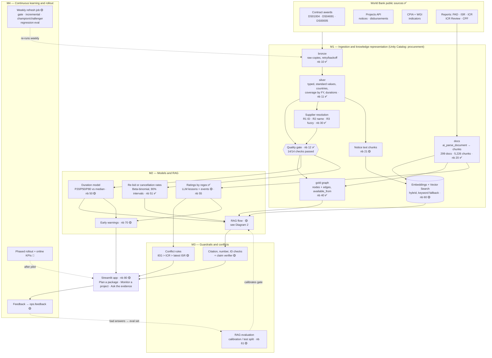
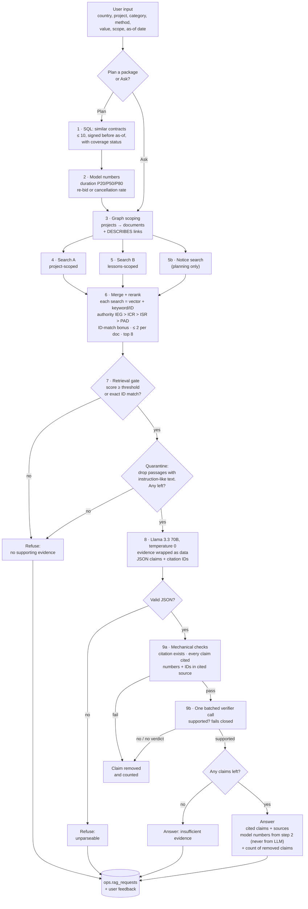
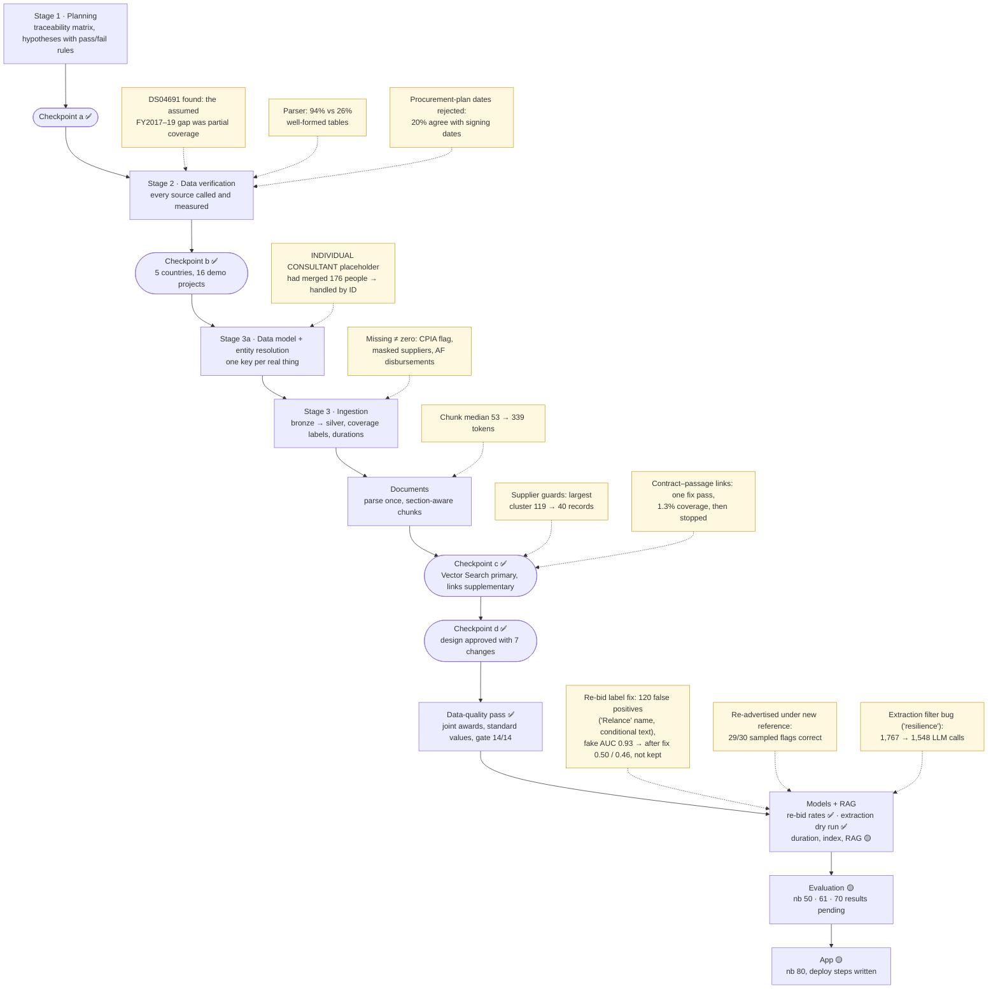

# 10 — Diagrams for the interview

Status as of 2026-10-22, taken from `notebooks/README.md`, `docs/00`, `docs/06` and `docs/07`:

- ✅ **done and run** on Databricks (numbers measured)
- 🟡 **written and unit-tested, not yet run** on Databricks (203 local unit tests pass)
- 📝 **proposed only** (written up in `docs/08_proposal.md`)

---

## Diagram 1 — System architecture

**What I'd say:** "Everything runs inside one Databricks workspace, governed by Unity Catalog. Public World Bank data
comes in raw to bronze, so I never have to call the APIs again to fix a cleaning bug. Silver types and standardises it,
maps old country codes and labels how complete each fiscal year is. Before anything downstream runs, an automated
quality gate checks the data and stops the pipeline if a check fails; on the full data it passed 14 of 14. From silver
I resolve suppliers and build a knowledge graph as two plain Delta tables, nodes and edges, where every edge records
when the fact became public, so models can't see the future. Reports are parsed once with `ai_parse_document`, cut into
section-aware chunks and embedded into Vector Search, which is the main retrieval path. The models produce the
numbers, the RAG flow finds the evidence, guardrails check every claim, and the app shows all three. A weekly job
re-runs the whole chain incrementally, retrains with a champion/challenger rule and fails if retrieval gets worse. The
ingestion, cleaning, graph and documents have run; the models, index, RAG and app are written and unit-tested but
still waiting for their first run."

---

## Diagram 2 — RAG request flow (status: 🟡 code unit-tested with fakes, not yet run on Databricks)

**What I'd say:** "This is a fixed sequence of tools, not a free-roaming agent, so every answer is reproducible and
the same code runs in my tests, my evaluation and the app. When a planner describes a package, SQL first finds
similar past contracts, and the models give the duration range and the re-bid-or-cancellation rate. Those numbers
never come from the LLM. The graph then narrows the search to the right projects, and I run hybrid searches, vector
plus keyword, because embeddings are bad at codes like contract references. After reranking, which favours the
independent IEG review over self-evaluations, a retrieval gate refuses if the evidence is weak; its threshold is
calibrated on half of my evaluation questions and reported on the other half. Passages that look like instructions
are held back entirely. Llama writes JSON claims, each with citations. Code then checks every claim: the citation
exists, and every number and ID appears in the cited text. A single verifier call then reads each claim next to its
source and removes anything not clearly supported. The answer says how many claims were removed, and every request is
logged."

---

## Diagram 3 — Build timeline

**What I'd say:** "I built this in stages with four checkpoints where I stopped for review. I started with a
traceability matrix so nothing in the brief got lost, and wrote my assumptions as hypotheses with pass/fail rules
decided in advance. Then I checked every data source before writing a pipeline, and that paid off: a third contract
dataset filled what I'd assumed was a three-year gap, and the procurement-plan dates agreed with official signing dates
only 20% of the time, so I dropped them from the models. During ingestion I treated missing values as missing, never as
zero, and measured chunk size instead of guessing it. Several fixes came from looking at real data rather than trusting
tests. The clearest is the re-bid label: a French project name containing 'Relance', which means recovery, plus
conditional boilerplate created 120 false positives and an AUC of 0.93 that was fake. After the fix the classifier
scored 0.50, and 0.46 on the latest run, so I didn't keep it and report rates with uncertainty instead. The data, documents and graph have run; the
model, retrieval evaluation and app runs are next."
